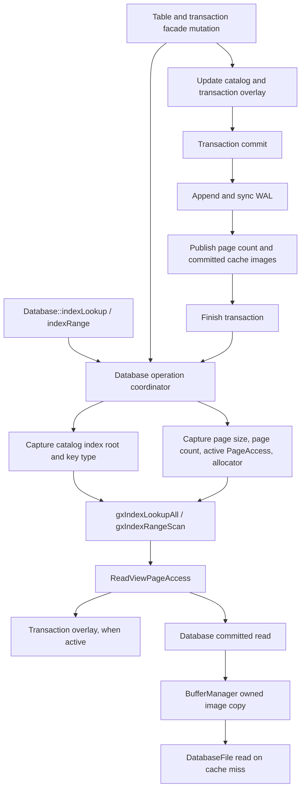

# NDB1R4P11R3AE — SQL Page Publication Read View

## Result

**Outcome A — `SQL_OPERATION_READ_VIEW_VERIFIED`.** The hosted SQL `Database`
now provides an operation-lifetime read view for `indexLookup` and `indexRange`.
Within the stated single-handle facade scope, the view binds the index root,
page-size/page-count metadata, transaction overlay selection, and page reads
under one publication coordinator. Transaction-managed writers use that same
coordinator for overlay/catalog changes and committed publication.

This is operation-level consistency. It does not provide a transaction-start
snapshot or historical page versions. A reader using the same `Database` object
while an explicit transaction is active observes the current transaction page
view, including completed uncommitted operations, matching the existing
`Database::pages()` selection behavior.

## Repository state and phase markers

- Repository: `D:\dev\guideXOS_SqlDatabase`.
- Branch: `main`.
- Starting HEAD: `866db3a0bf6a22d56009848d4fbf236a4f533d5e` (the requested R3AD
  starting revision).
- Starting worktree: clean; branch was three commits ahead of `origin/main`.
- `.phase`: SQL9 → SQL10; SHA-256
  `f84ef02a6b82d4c53cdb2bdd0b80c083a49c6fa2e5df46914d9aadd7555295f0`.
- `.native-sql.phase`: NDB1R4P10 → NDB1R4P11; SHA-256
  `fe722cf1a92a04c9f16e91e556933c682a7e3475bf3aabb06ce994410a28a52a`.
- Neither phase marker changed. No Server repository, guest integration,
  database/WAL format, or recovery ordering changed.
- Ending qualified implementation HEAD: `49f0db6a82ccb1fac7bcf41d48c6a9b4acba6dc6`.

## Publication and locking audit

### Existing storage and transaction contracts

`PageAccess` has no snapshot, root handoff, or multi-page borrow contract.
`Database` selects its active `Transaction` overlay in `Database::pages()`;
transaction reads use an overlay image first and otherwise read the current
committed `Database` view below the transaction's captured base page count.
That count does not retain historical page images.

The hosted committed page read path copies an image through
`BufferManager::readOwnedPage` and parses it into an owned `DatabasePage`.
Index traversal does not pin a cache slot; its provider borrows bytes from its
operation-owned hosted page until release. The buffer cache has no independent
locking, snapshot, or history mechanism. Individual pin counts do not bind
multiple page reads to one version.

Index root IDs live in the in-memory `Catalog::IndexRecord`. Table insert and
mutation paths may update that root and transaction overlay pages before
commit. Commit then appends `BEGIN`, page images, an optional header image, and
`COMMIT`; syncs the WAL; updates the file page count; installs page images in
the committed cache one by one; and finishes the transaction. Previously there
was no shared synchronization between a lookup and any part of this process.

Recovery replays committed WAL records directly to `DatabaseFile` while
opening a `Database`, before the handle is made available to callers. Flush
writes dirty buffer pages and checkpoints the WAL. The R3AE coordinator now
protects facade flush/close and transaction publication, while recovery remains
an open-time operation.

### Explicit publication dependency graph

### Selected coordination and lifetime

The repository had no reusable reader/writer lock: transaction state only
enforced one active writer, and the buffer manager explicitly had no internal
locking. The bounded hosted solution is one `std::recursive_mutex` owned by a
`Database` instance. Recursive acquisition supports the existing synchronous
composition of Database, Transaction, and Table operations on the same thread.
Readers serialize with one another as well as writers.

`Database::acquireReadView` retains this coordinator and captures the selected
page view, page size, logical page count, transaction pointer, and traversal
allocator. `DatabaseReadView::indexRoot` copies the root ID and key type while
the coordinator is held. A read-only `PageAccess` wrapper enforces the captured
page bounds. The operation executes the existing `gxIndexLookupAll` or
`gxIndexRangeScan` algorithm through `IndexTree` and the hosted page provider.
Provider page borrows are released during traversal. Locators are staged in an
owned vector; on success the view is released before the output vector is
published. All error exits release the view through RAII and leave output
empty.

The lock order is: Database operation coordinator → catalog/transaction
overlay → WAL for commit → DatabaseFile page-count update → BufferManager page
installation. Reads use: Database operation coordinator → catalog/root capture
→ transaction overlay or committed Database → BufferManager → DatabaseFile on
cache miss. The hosted cache and file do not acquire a second database lock, so
there is no reverse lock order. Traversal has no user visitor callback. A
same-thread facade mutation attempted reentrantly while a view is active fails
with `Internal` instead of recursively publishing through the held coordinator.
The view must be released on its acquiring thread, and the Database must
outlive it.

### Writer participation and visibility

The same coordinator covers the transaction-managed production paths that can
change pages or root metadata used by these index operations:

- `Table::insert`, `Table::applyMutations`, and `Table::alterAddColumn`, across
  heap/index overlay changes and catalog root/count updates.
- `Transaction::createTable`, `Transaction::createIndex`, overlay writes and
  allocation, statement savepoints, commit, and rollback.
- Database DDL wrappers and `Database::buildIndex`.
- `Database::writePage`, committed image installation, flush, and close.
- WAL sync through transaction commit, page-count change, cache publication,
  and transaction completion.

Catalog root changes and matching transaction-local index pages therefore
cannot change during an active read view. Commit's existing WAL durability
ordering is unchanged; its entire publication step is protected. A reader
started between completed statements of an explicit transaction sees that
transaction's current overlay/catalog state as a coherent operation view; it
does not get a historical view from transaction start.

The hosted adapter reads copied page images and retains no cache pin or page
pointer after release. Repeated point/range operations under an explicitly
retained `DatabaseReadView` see the same metadata and page set. A long range
scan holds the coordinator for its complete traversal and result staging, so a
writer waits until release. This blocking is intentional and was exercised by
the deterministic test.

## Supported scope and unsupported publication paths

The verified scope is a single-process hosted caller using one `Database`
instance and its transaction/table/DDL facade APIs. It does not coordinate:

- A second `Database` handle opened on the same path, even in the same process.
- Another process, a native Server writer, or external database-file changes.
- Direct multi-page index publication through `IndexTree`, raw
  `Transaction::writePage`, `DatabaseFile`, `BufferManager`, or mutable
  `Database::catalog()` accessors. Such low-level facilities are exposed for
  storage/tests and do not form a coordinated multi-page SQL operation.
- Historical transaction-start reads or retained old page images.
- Recovery running concurrently with a live handle; recovery is only qualified
  during open on that handle.
- Reader cancellation; the current point/range API has no cancellation input.

The lock is process-local and handle-local. The tests are not evidence of
cross-process file safety. Code that uses the raw lower-level mutators must
serialize them externally and must not treat their multi-call page updates as
atomic index publication.

## R3AE focused qualification

The dedicated `database_ndb1r4p11r3ae_test` target creates an isolated 512-byte
page database using production `Database`, `Table`, transaction, and index
writers. It covers an empty index, leaf root, multilevel tree, point lookup,
bounded duplicate range, one-sided and unbounded ranges, 81 duplicates spread
across leaves, transaction-local overlay reads and rollback, captured root and
page metadata, repeated reads, zero outstanding cache pins, and page-image
immutability across read operations.

For concurrency, the test holds a real `DatabaseReadView`, checks from another
thread that the production coordinator is unavailable, and releases a writer
through a condition-variable barrier. The writer inserts 80 duplicate rows,
causing a root change and additional leaf/internal pages. While the view is
held, repeated point/range results remain exactly the old one-row state and
root/page count remain unchanged. After view release the writer completes; a
later point/range read returns all 81 rows, with a new root and larger page
count. No operation returns a mix of the before/after result sets.

Failure cleanup injects an out-of-range root, a corrupt internal root, and a
corrupt first-leaf successor after range results have been staged. Each call
returns an error and leaves the caller's result empty; a new read view can be
acquired afterward. The test also verifies rejected reentrant publication,
rollback of a transaction-local write, and no pin leak. Reader cancellation is
not implemented.

R3AE result: **98 checks passed, 0 failed**. The R3Z–R3AE focused CTest set
passed **6/6**. Focused assertion results:

- R3Z: **4,186 passed, 0 failed**.
- R3AA: **4,018 passed, 0 failed**.
- R3AB: **1,354 passed, 0 failed**.
- R3AC: **1,008 passed, 0 failed**.
- R3AD: **339 passed, 0 failed**.
- R3AE: **98 passed, 0 failed**.

## Regression qualification

The established transaction, WAL, recovery, corruption, page/cache, SQL, and
portable runtime tests were run as part of the full Debug CTest aggregate.
Final aggregate result: **35/35 passed, 0 failed** in **1,099.62 seconds**.
CTest does not expose a combined assertion count; no aggregate assertion total
is inferred.

The lock was added outside WAL and portable B+ tree algorithms. Commit record
ordering, WAL sync placement, rollback behavior, recovery replay order, and page
formats are unchanged. WAL, recovery, and rollback compatibility are preserved
by the passing full regression suite.

## Freestanding qualification and sanitizer status

The established `tools/qualify_sql9_freestanding.ps1` census ran with MinGW
15.2.0 and the checked Server kernel tree. Result: **26/44 passing**, preserving
all 26 previous passing units. The first `database/database_index.cpp`
blocker remains `database/database_index.h:27:10: fatal error: string: No such
file or directory` under `-nostdinc++`. No new census blocker was introduced.

The production key-boundary, internal descent, complete-lookup, and range
probes each passed compile, relocatable link with `--no-undefined`, and hosted
execution. All report no unresolved production symbols. The portable B+ tree
implementation has no hosted synchronization dependency.

`SANITIZER_NOT_RUN — TOOLCHAIN_UNAVAILABLE`. `clang++`, `clang-cl`, and MSVC
`cl.exe` are unavailable. MinGW reports only bare `libasan` and `libubsan`
library names, so no compatible sanitizer execution was claimed or attempted.

## Readiness assessment

| Capability | Assessment |
|---|---|
| Stable root identity | Proven within the single-handle facade scope |
| Stable committed page view | Proven within the single-handle facade scope |
| Transaction-overlay consistency | Proven for guarded transaction/table operations |
| Writer publication coordination | Proven for transaction-managed facade writers |
| In-process concurrent reader/writer behavior | Verified for one `Database` instance |
| Cross-process coordination | Unsupported |
| Point lookup through protected view | Verified |
| Range scan through protected view | Verified |
| Failure atomicity | Verified for provider/traversal errors in the existing and R3AE tests |
| WAL/recovery compatibility | Preserved; full Debug CTest passed 35/35 |
| Native guideXOS Server execution | Not tested |

This qualifies a future hosted adapter that uses the same `DatabaseReadView`
and transaction/table publication paths. It does not yet qualify a native
Server adapter: the Server bridge previously inspected supplies positional
file I/O only, this coordinator does not cover independent file handles or
processes, and native SQL compilation/execution remains unverified.

## Recommended next bounded phase

Before implementing a Server page-provider adapter, determine the Server's
database-handle ownership and whether more than one handle/process can publish
the same file. If access is truly single-handle, adapt the Server storage
boundary to acquire the corresponding read view and keep it alive through
`gxIndexLookupAll`/`gxIndexRangeScan`; then compile and run it in the real Server
target. If multiple handles or processes are supported, first add and qualify
file-scoped/interprocess publication coordination at the Server storage
boundary. Do not infer that guarantee from this hosted per-instance mutex.

No Server code or native adapter was changed in R3AE.
